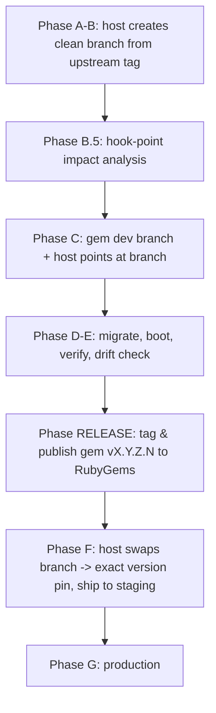

# Internal Runbook — Upgrading `newsmast_mastodon` for a New Mastodon Version

> **Audience: internal maintainers only.** This is for the team that develops
> and releases the `newsmast_mastodon` engine gem. It is **not** a guide for
> downstream consumers upgrading the gem dependency in their own app.

This is the single source of truth for upgrading the host Mastodon snapshot
(`patchwork-mastodon`) together with the `newsmast_mastodon` engine gem.

The outcome of every cycle is **one released gem version per Mastodon
version** (`X.Y.Z.N` for Mastodon `X.Y.Z`), so any developer running Mastodon
`X.Y.Z` can install the matching gem without modifying their own code.

> **Why this lives in the gem repo:** the gem defines the compatibility
> contract (`mastodon_version_requirement` metadata, shipped migrations,
> prepended concerns, vendored frontend/Chewy overrides). The host app only
> *consumes* a released, version-pinned gem. Keeping the runbook next to the
> contract it describes prevents the two from drifting apart.
>
> **Host modification policy:** `patchwork-mastodon` is treated as an
> upstream snapshot. The host upgrade branch is created directly from the
> upstream release tag and contains **no hand-written Patchwork/Newsmast
> code**. All customization lives in the engine gem. Deployment configuration
> is managed by DevOps outside this repository.
>
> The only files that may differ from the upstream tag are **generated
> artifacts** of installing the gem:
>
> | File(s) | Produced by |
> | --- | --- |
> | `Gemfile`, `Gemfile.lock` | adding/pinning `newsmast_mastodon` + `bundle install` |
> | `db/schema.rb`, model schema annotations | `bin/rails db:migrate` (gem migrations) |
> | `.newsmast_mastodon_installed` | `bin/rails newsmast_mastodon:install` |
> | `app/chewy/accounts_index.rb`, `app/chewy/statuses_index.rb`, `app/chewy/public_statuses_index.rb` | `bin/rails newsmast_mastodon:install` |
> | Compose JS/JSX overrides and `federated_dropdown*` (see Phase E.3) | `bin/rails newsmast_mastodon:install` |
> | `app/views/admin/shared/_status.html.haml` | `bin/rails newsmast_mastodon:install` |
>
> Any other diff against `v<TO_VERSION>` is a policy violation and must be
> moved into the gem.
>
> **How the gem modifies the host:**
>
> - *Runtime (no files touched):* migrations ship from `db/migrate/` and are
>   appended by `lib/newsmast_mastodon/engine.rb`; concerns, services,
>   serializers and controller overrides are `include`d/`prepend`ed at boot by
>   `config/initializers/prepend_concerns.rb`; the Doorkeeper password grant is
>   registered in `engine.rb`.
> - *Install-time (files copied):* `lib/tasks/newsmast_mastodon/install.rake`
>   copies the gem's Chewy indexes (`app/chewy/newsmast_mastodon/*.rb`) and
>   frontend/view overrides **over** the host's upstream files. (The boot-time
>   Chewy constant swap in `prepend_concerns.rb` is currently commented out.)
>
> Downstream consumers who add the gem to their own Mastodon host receive the
> same modifications through the same two mechanisms.

## How to use this document

1. At the start of a cycle, update the **Release intake** block below in this
   file for the new versions.
2. Copy the intake block into a new file under [`reports/`](./reports/) named
   `report-<TO_VERSION>.md`.
3. Work top-to-bottom through the phases, checking items off in **your report
   copy** (not in this file). Record the Phase B.5 impact table in the report.
4. If a cycle reveals a missing or wrong step, fix it here so the next cycle
   benefits.

---

## Dependency model (canonical)

The host app pins an **exact, released gem version** — never a floating
constraint and never a long-lived git branch in production:

```ruby
# patchwork-mastodon/Gemfile
gem "newsmast_mastodon", "X.Y.Z.N"
```

A git `branch:` source is permitted **only** during active upgrade development
(Phase C). It must be replaced with an exact version pin before staging
(Phase F). This matches the gem `README.md` policy and avoids unplanned
compatibility drift.

Versioning is compatibility-first (see [`release.md`](./release.md)):
`X.Y.Z` = target Mastodon version, `N` = gem patch level for that line. A new
Mastodon target always resets to `.0`.

## Branch & tag naming (canonical)

| Repo                 | Purpose            | Pattern                       | Example                          |
| -------------------- | ------------------ | ----------------------------- | -------------------------------- |
| `newsmast_mastodon`  | upgrade dev branch | `mastodon-X.Y.Z`              | `mastodon-4.6.10`                |
| `newsmast_mastodon`  | gem patch branch   | `mastodon-X.Y.Z.N`            | `mastodon-4.6.5.3`               |
| `newsmast_mastodon`  | release tag        | `vX.Y.Z.N`                    | `v4.6.10.0`                      |
| `patchwork-mastodon` | upgrade branch     | `patchwork-mastodon-X.Y.Z`    | `patchwork-mastodon-4.6.10`      |
| `patchwork-mastodon` | deploy branch      | `csidnet-X.Y.Z-<stage>`       | `csidnet-4.6.10-production`      |

The `patchwork-mastodon` upgrade branch is a **clean upstream snapshot**
created from `v<TO_VERSION>` plus only the generated artifacts listed in the
host modification policy.

Do not introduce ad-hoc suffixes (e.g. `mastodon-4512-signup`); feature work
belongs on short-lived branches that merge into `mastodon-X.Y.Z` before release.

---

## Release intake (update at the start of each cycle — copy into your report)

```text
FROM_VERSION:    4.6.10
TO_VERSION:      4.7.6
TARGET_TAG:      https://github.com/mastodon/mastodon/releases/tag/v4.7.6
BASE_BRANCH:     patchwork-mastodon-4.6.10
UPGRADE_BRANCH:  patchwork-mastodon-4.7.6
CORE_REMOTE:     https://github.com/mastodon/mastodon.git
GEM_REPO:        https://github.com/patchwork-hub/newsmast_mastodon
GEM_BASE_BRANCH: mastodon-4.6.10   # latest gem branch for FROM_VERSION (or main if merged)
GEM_DEV_BRANCH:  mastodon-4.7.6    # mastodon-<TO_VERSION>
GEM_VERSION:     4.7.6.0           # released gem version pinned by the host
HOST_MODIFICATION_POLICY: upstream snapshot + generated gem artifacts only;
                          all customization ships via newsmast_mastodon
```

## What to collect for each release

- [ ] Release-notes delta for `FROM_VERSION -> TO_VERSION` (read **every**
      patch release in the range, not just the target).
- [ ] Upstream `### Security` entries and GHSA IDs in the range. Each one must
      be checked against the gem in Phase B.5 — a gem override can silently
      undo a security fix.
- [ ] Count and names of upstream core migrations introduced in the range
      (`git diff --name-only v<FROM> v<TO> -- db/migrate db/post_migrate`).
- [ ] Ruby / Node version bumps (`.ruby-version`, `.nvmrc`, `Dockerfile`)
      versus the gemspec `required_ruby_version` and the gem CI matrix.
- [ ] Major dependency jumps (especially the auth/session stack).
- [ ] Phase B.5 hook-point impact table.
- [ ] Upstream changes to any file the gem **vendors** (see Phase E.3).
- [ ] Estimated risk summary for this cycle.

---

## Coordinated release sequence (read first)

The upgrade spans two repos and must happen in this order:



The gem is **released first**; the host then pins the released version. Never
ship a host deploy that points at a git branch.

---

## Pre-flight

- [ ] Clean working tree in both repos: `git status`.
- [ ] `upstream` remote on the host matches `CORE_REMOTE`, and
      `git fetch upstream --tags` shows `v<TO_VERSION>`.
- [ ] `GEM_BASE_BRANCH` contains every released gem patch for `FROM_VERSION`
      (check `CHANGELOG.md` / tags), and is merged to `main` or noted in the report.
- [ ] Backup the staging database before any migration.
- [ ] Credentials/env available for boot, migration, and test runs in both repos.
- [ ] Gem CI is green on `GEM_BASE_BRANCH` before starting.
- [ ] Confirm with DevOps that deployment configuration for the target stage
      is ready and will be injected outside this repository.

## Phase A-B — Create host snapshot branch (host)

The host upgrade branch is created directly from the upstream release tag.
No merge is performed and no hand-written Patchwork code is added to the host.

```bash
cd patchwork-mastodon
git fetch upstream --tags
git checkout -b <UPGRADE_BRANCH> v<TO_VERSION>
```

Then:

- [ ] Confirm `lib/mastodon/version.rb` reports `TO_VERSION`.
- [ ] Confirm `git log --oneline -1` shows the upstream release commit.
- [ ] Confirm the working tree is clean except for env/config files excluded
      by `.gitignore`.

## Phase B.5 — Hook-point impact analysis (gem vs upstream)

This phase answers: **did upstream change code that the gem customizes?** Do
it before touching the gem, and record the result in the report.

1. List upstream Ruby/config files changed in the range:

   ```bash
   cd patchwork-mastodon
   git diff --name-only v<FROM_VERSION> v<TO_VERSION> -- app lib config/initializers \
     | grep -v -e '/locales/' -e '\.json$' -e '\.scss$' -e '^spec/'
   ```

2. List the host classes the gem hooks into:

   ```bash
   grep -nE '^\s*[A-Z][A-Za-z:]+\.(prepend|include)\(' \
     ../newsmast_mastodon/config/initializers/prepend_concerns.rb
   grep -n 'class_eval' ../newsmast_mastodon/config/initializers/prepend_concerns.rb
   ```

3. For every changed upstream file whose class appears in step 2:

   - List the methods the gem module defines: `grep -n 'def ' <gem module file>`.
   - Diff the upstream file: `git diff v<FROM_VERSION> v<TO_VERSION> -- <file>`.
   - If a changed upstream method is **redefined** by the gem, read both
     versions side by side.

4. Pay special attention to **full-method copies** — gem overrides that
   reimplement an upstream method instead of calling `super`. Upstream fixes
   inside those methods are silently dropped. Known full-method copies (keep
   this list current):

   | Gem module | Overrides | Upstream source |
   | --- | --- | --- |
   | `NewsmastMastodon::Concerns::AccountsCreation` | `Api::V1::AccountsController#create` | `app/controllers/api/v1/accounts_controller.rb` |
   | `NewsmastMastodon::Overrides::PostStatusServiceExtension` | `PostStatusService#postprocess_status!`, `#status_attributes` | `app/services/post_status_service.rb` |
   | `NewsmastMastodon::Overrides::ExtendedAccountStatusesFilter` | `AccountStatusesFilter#results` | `app/lib/account_statuses_filter.rb` |
   | `NewsmastMastodon::Concerns::OverridePrepareNewUser` | `User#prepare_new_user!` | `app/models/user.rb` |

   `DraftStatusService` was refactored into `super`-calling hooks in 4.6.10.0
   and is no longer a full copy of `PostStatusService#call`. Note that
   `before_action`s on an overridden controller action still run, so upstream
   fixes in those callbacks are inherited.

   Also check **callback ordering**: gem `class_eval`/`before_action`
   additions run *after* upstream callbacks unless they use
   `prepend_before_action`.

   Prefer refactoring these into small `super`-calling hooks when touched.

5. Also check, in the same diff range:

   - `app/chewy/` (gem copies replace these files — see Phase E.5).
   - `config/initializers/doorkeeper.rb` and `devise.rb` (the gem registers a
     Doorkeeper password grant in `engine.rb`).
   - `app/controllers/concerns/auth/` and `app/controllers/auth/` (the gem
     prepends session/token behavior).

6. Record the result in the report:

   ```markdown
   | Upstream file | Gem hook | Changed methods overlap gem? | Verdict (Compatible / Needs fix / Fixed) |
   | --- | --- | --- | --- |
   ```

Every **Needs fix** row becomes a Phase C task.

## Phase C — Gem changes & temporary wiring

1. In the gem, branch from `GEM_BASE_BRANCH`:

   ```bash
   cd newsmast_mastodon
   git checkout <GEM_BASE_BRANCH> && git pull --ff-only
   git checkout -b <GEM_DEV_BRANCH>
   ```

2. Update the compatibility contract:

   - [ ] `lib/newsmast_mastodon/version.rb` → `VERSION = "<GEM_VERSION>"`
   - [ ] `newsmast_mastodon.gemspec` → `mastodon_version_requirement = "<TO_VERSION>"`
   - [ ] `README.md` compatibility section
   - [ ] `CHANGELOG.md` (`Unreleased` → new section; make sure every earlier
         gem patch release is also listed)

   Run the sync check to confirm all four agree:

   ```bash
   bundle exec rspec spec/compatibility/version_sync_spec.rb
   ```

3. Fix every **Needs fix** row from the Phase B.5 table (patched concerns,
   services, controllers, serializers) and add a spec for each upstream
   behavior the fix must preserve.

4. If upstream changed any `app/chewy/*` index the gem replaces, re-base the
   gem copy under `app/chewy/newsmast_mastodon/` onto the new upstream file and
   re-apply the fork-specific scopes (e.g. `without_banned`).
   `install.rake` copies these files over the host's `app/chewy/`.

5. Guard every gem migration (see Phase D). Run:

   ```bash
   bundle exec rspec spec/compatibility/migration_guard_spec.rb
   ```

6. **Temporarily** point the host Gemfile at the dev branch for integration,
   using the same repository defined in `GEM_REPO` from the Release intake block:

   ```ruby
   gem "newsmast_mastodon",
       git: "<GEM_REPO>",
       branch: "<GEM_DEV_BRANCH>"
   ```

   ```bash
   cd ../patchwork-mastodon && bundle install
   ```

7. Update the gem CI default host ref so host-mode CI tests the new snapshot:
   `.github/workflows/ci.yml` → `host_mastodon_ref` default = `<UPGRADE_BRANCH>`.

> Because the host repo is an upstream snapshot, **every** Patchwork/Newsmast
> customization must be present in the gem. If a feature currently relies on a
> file that was previously committed to the host fork, that file must be moved
> into the gem (concern, override, rake task, or initializer) before release.

## Phase D — Database and boot (host)

0. Install first. The gem's installation guard
   (`lib/newsmast_mastodon/installation_guard.rb`) refuses to boot the app,
   including `db:migrate`, until the install marker and copied files exist:

   ```bash
   RAILS_ENV=development bin/rails newsmast_mastodon:install
   ```

   Check that the target database is really at `FROM_VERSION`:
   `bin/rails db:migrate:status | grep 'NO FILE'` must be empty on the new
   snapshot. Entries there mean the DB was migrated by a newer Mastodon. Use
   a different DB, or load the base branch's schema into a scratch DB:

   ```bash
   git show <BASE_BRANCH>:db/schema.rb > /tmp/schema-base.rb
   DB_NAME=<scratch_db> bin/rails db:create
   DB_NAME=<scratch_db> SCHEMA=/tmp/schema-base.rb bin/rails db:schema:load
   ```

1. Apply migrations against a **staging clone first**:

   ```bash
   bin/rails db:migrate
   ```

   Then `git diff <BASE_BRANCH> -- db/schema.rb` should show only changes
   caused by new upstream or gem migrations in this range.

   > No migration files may be added to the host repo. All schema changes
   > ship from the gem engine and must be idempotent.

2. Confirm no collision with columns that upstream may now ship natively:
   - `status_edits.quote_id`
   - `statuses.fetched_replies_at`
   - `statuses.local_only`
   - `announcements.notification_sent_at`
   - any column/table introduced by the upstream migrations collected above

   All gem migrations must be idempotent (`if_not_exists` / `column_exists?` /
   `table_exists?`); the `migration_guard_spec` enforces this in CI.

3. Build the frontend with the gem overrides installed in step 0:

   ```bash
   yarn build:development   # or build:production
   ```

   After running install, `git status` in the host repo should show only the
   generated artifacts listed in the host modification policy.

4. Verify boot and version:

   ```bash
   bin/rails runner 'puts Mastodon::Version.to_s'
   ```

   Watch the log for the gem's runtime compatibility assertion. A mismatch
   between `Mastodon::Version` and the gem's `mastodon_version_requirement`
   warns in development/test and **aborts** in production.

## Phase E — Verification gates

1. Gem suite (standalone):

   ```bash
   cd newsmast_mastodon && bundle exec rspec
   ```

2. Gem suite against the upgraded core (host mode):

   ```bash
   MASTODON_ROOT=/absolute/path/to/patchwork-mastodon bundle exec rspec
   ```

3. **Override drift check** — the gem vendors copies of upstream files. The
   drift manifest in [`config/override_baselines.yml`](../../../config/override_baselines.yml)
   must include every upstream file copied by
   [`lib/tasks/newsmast_mastodon/install.rake`](../../../lib/tasks/newsmast_mastodon/install.rake).
   Drift is detected by comparing the upstream file in the host snapshot
   against the recorded baseline. If upstream changed any tracked file in this
   range, re-base the vendored copy, then re-record the baseline.

   Tracked upstream override paths:
   - `app/javascript/mastodon/actions/compose.js`
   - `app/javascript/mastodon/reducers/compose.js`
   - `app/javascript/mastodon/features/compose/components/compose_form.jsx`
   - `app/javascript/mastodon/features/compose/containers/compose_form_container.js`
   - `app/javascript/mastodon/features/status/components/detailed_status.tsx`
   - `app/views/admin/shared/_status.html.haml`
   - `app/chewy/accounts_index.rb`
   - `app/chewy/statuses_index.rb`
   - `app/chewy/public_statuses_index.rb`

   Gem-only files (no upstream counterpart, `upstream: false`):
   - `app/javascript/mastodon/features/compose/components/federated_dropdown.jsx`
   - `app/javascript/mastodon/features/compose/containers/federated_dropdown_container.js`

   Run the check against a **clean** `v<TO_VERSION>` checkout (before
   `newsmast_mastodon:install` overwrites the files), or compare with
   `git show v<TO_VERSION>:<path>`:

   ```bash
   bin/check-override-drift /absolute/path/to/patchwork-mastodon
   ```

4. **Override-manifest completeness check** — confirm every upstream file
   copied by `install.rake` (frontend, views **and** Chewy) has a matching
   `upstream: true` entry in `config/override_baselines.yml`. New overrides
   added to the rake task must also be added to the manifest before the drift
   check can protect them.

5. **Chewy compatibility gate** — compare upstream `app/chewy/*` and Chewy
   gem/DSL changes in this release range against the gem copies under
   `app/chewy/newsmast_mastodon/`. Confirm custom scopes (e.g.
   `without_banned`) are still valid after `newsmast_mastodon:install`, and
   that `bin/tootctl search deploy` succeeds.

6. Concern/prepend ordering boot check — confirm no `already defined` /
   `NoMethodError` from `config/initializers/prepend_concerns.rb`.

7. Host core suite:

   ```bash
   cd patchwork-mastodon && bundle exec rspec
   ```

8. Manual smoke checklist:
   - [ ] Login / session (web)
   - [ ] Login with 2FA enabled
   - [ ] LDAP / PAM / SSO login (if enabled for this deployment)
   - [ ] OAuth token issuance (Doorkeeper password grant)
   - [ ] Account registration via `POST /api/v1/accounts` (with and without
         `SSO_ACCOUNT_SIGN_UP`)
   - [ ] Password change / reset flow
   - [ ] Post create / edit / draft create & publish
   - [ ] Double-submit of a post with the same `Idempotency-Key`
   - [ ] Local-only post behavior
   - [ ] Custom feeds / timelines (home, public, tag, list, account)
   - [ ] Banned-keyword filtering and search (`without_banned`)
   - [ ] Admin authentication / dashboard (incl. a disabled moderator is denied)
   - [ ] Deep links (`apple-app-site-association`, `assetlinks.json`)
   - [ ] One check per upstream **Security** entry collected for this cycle

9. Classify any failure as:
   - [ ] Environment/infrastructure (missing services, credentials, tooling)
   - [ ] Regression in the upstream snapshot for this version
   - [ ] Regression in patched gem behavior
   - [ ] Vendored-override drift

## Phase RELEASE — Publish the gem

Only after all Phase E gates pass on the gem dev branch:

1. Confirm the consumer-facing deliverables, so any Mastodon `<TO_VERSION>`
   instance can install the gem without extra help:
   - [ ] `README.md` contains "`<GEM_VERSION>` is the first gem release for
         Mastodon `<TO_VERSION>`" (enforced by `version_sync_spec`).
   - [ ] `CHANGELOG.md` section for `<GEM_VERSION>` lists upstream-driven fixes
         and any new migrations / install steps.
   - [ ] README install snippet is still accurate:

     ```ruby
     gem "newsmast_mastodon", "<GEM_VERSION>"
     ```

     ```bash
     bundle install
     bin/rails newsmast_mastodon:install
     bin/rails db:migrate
     yarn build:production
     ```

2. Open a PR `<GEM_DEV_BRANCH>` → `main`; require green CI.
3. Merge, then release per [`release.md`](./release.md):

   ```bash
   git checkout main && git pull --ff-only
   git tag -s v<GEM_VERSION> -m "Release v<GEM_VERSION>"
   git push origin v<GEM_VERSION>
   ```

4. Confirm the version is live on RubyGems
   (`gem install newsmast_mastodon --version <GEM_VERSION>`).

## Phase F — Pin & ship to staging (host)

1. Replace the temporary branch source with the released, exact pin:

   ```ruby
   gem "newsmast_mastodon", "<GEM_VERSION>"
   ```

   ```bash
   bundle install
   ```

2. Before committing, verify the host diff contains only generated artifacts:

   ```bash
   git diff --stat v<TO_VERSION>
   ```

   Expected: `Gemfile`, `Gemfile.lock`, `db/schema.rb` (+ model schema
   annotations), `.newsmast_mastodon_installed`, and the files copied by
   `newsmast_mastodon:install`. Anything else must move into the gem.

3. Commit, push `<UPGRADE_BRANCH>`, deploy `csidnet-<TO_VERSION>-staging`.
4. Re-run the smoke checklist in staging.
5. Record the go/no-go decision in your report.

## Phase G — Production

1. Deploy `csidnet-<TO_VERSION>-production` once staging passes.
2. Record deployment time and any issues in the report.

---

## High-risk watchlist (every release)

- [ ] Upstream **security fixes** inside methods the gem overrides (Phase B.5).
- [ ] **Full-method copies** in the gem (Phase B.5 step 4) — they silently drop
      upstream fixes made inside the copied method.
- [ ] Auth stack: Devise / Doorkeeper / session strategy / 2FA / token flow
      changes (the gem registers a Doorkeeper password grant in `engine.rb`
      and prepends session/token controllers).
- [ ] Controller/service signature changes where gem concerns prepend/override.
- [ ] Model API changes affecting patched `Status`, `Quote`, `MediaAttachment`,
      `User`, `Account`, `Tag`, `Notification` concerns.
- [ ] Serializer/autoload constant changes that break gem namespace loading.
- [ ] Migration collisions where gem columns may already exist in core schema.
- [ ] Upstream changes to any **vendored** frontend/view/Chewy file (drift check).
- [ ] Override-manifest mismatch: any upstream file copied by `install.rake`
      but missing from `config/override_baselines.yml` reduces drift-check
      coverage.
- [ ] Ruby version bumps outside the gemspec `required_ruby_version` range.
- [ ] Upstream security hardening that changes request validation, federation,
      or URL checks.

## Rollback

Because the host branch is an upstream snapshot, rollback does not require
reverting merged code.

- [ ] Abandon `<UPGRADE_BRANCH>` if the release is blocked.
- [ ] Restore the database from the pre-migration backup snapshot.
- [ ] Re-pin the host Gemfile to the last known-good gem version and `bundle install`.
- [ ] Re-point deploy configuration to the last known-good branch/tag.
- [ ] Record the rollback reason and remediation tasks in the report.
